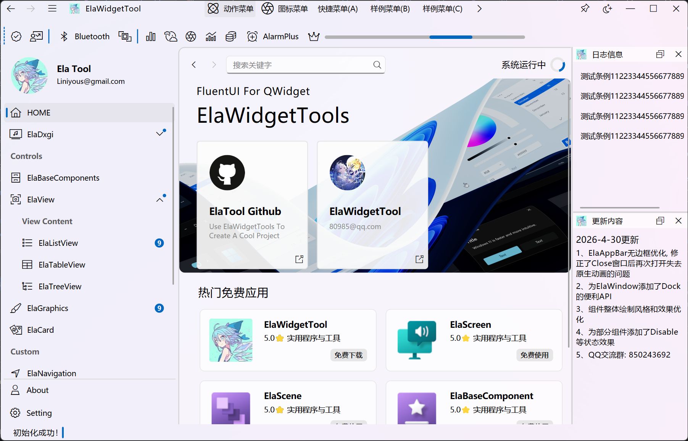

# ElaWidgetTools

**为 Qt Widgets 桌面应用打造的 Fluent 风格组件库**

基于上游独立演进 · 面向 Qt 6.12.0 及以上版本 · 规划支持 macOS

[组件目录](docs/components.md) · [维护与路线图](docs/roadmap.md) · [参与贡献](docs/contributing.md) · [示例源码](ElaWidgetToolsExample/)

---

## 关于项目

ElaWidgetTools 是基于 **C++ / Qt Widgets** 的桌面界面组件库，提供 Fluent 风格的控件、窗口、导航与主题能力，帮助你构建风格统一的桌面应用。

本仓库基于 [Liniyous/ElaWidgetTools](https://github.com/Liniyous/ElaWidgetTools) 开始独立维护，后续功能、版本策略与发布节奏由本仓库单独推进。

> **维护方向**：后续仅维护 **Qt 6.12.0 及以上版本**，并计划适配 **macOS**。当前仍处于从上游代码建立独立维护基线的阶段，构建配置尚未迁移，以上目标不代表已经完成兼容验证。详见[维护与路线图](docs/roadmap.md)。

## 能力一览

- **统一的视觉体验**：浅色与深色主题、图标、卡片及交互动画。
- **完整的窗口骨架**：无边框窗口、自定义标题栏、侧边导航、选项卡与停靠面板。
- **常用桌面控件**：按钮、输入框、日期选择、列表、表格、树形视图与进度展示。
- **丰富的交互组件**：消息提示、对话框、菜单、抽屉与 Ribbon 工具区。
- **配套示例与基础设施**：示例页面，以及事件总线、日志和图像模糊等辅助能力。

按功能查找组件，请阅读[组件目录](docs/components.md)；接口与用法以当前源码和[示例页面](ElaWidgetToolsExample/ExamplePage/)为准。

## 界面预览

以下为仓库随附的上游示例截图，用于展示界面风格。

<table>
  <tr>
    <th width="50%">浅色主题</th>
    <th width="50%">深色主题</th>
  </tr>
  <tr>
    <td></td>
    <td></td>
  </tr>
</table>

## 版本与平台

| 项目 | 维护方向 | 当前状态 |
| --- | --- | --- |
| Qt | 仅维护 Qt 6.12.0 及以上版本 | 迁移计划中，现有构建仍有旧版本限制 |
| Windows | 继续维护 | 已有上游实现，待建立本分支验证基线 |
| Linux | 继续维护 | 已有上游实现，待建立本分支验证基线 |
| macOS | 计划支持 | 尚未完成适配与验证 |

Qt 5 和 Qt 6.12.0 以下版本不纳入后续维护范围。构建迁移、平台验证与编译指南将在后续阶段推进。

## 文档导航

| 文档 | 内容 |
| --- | --- |
| [组件目录](docs/components.md) | 按功能分类浏览当前组件，直达头文件 |
| [维护与路线图](docs/roadmap.md) | 分支定位、Qt 版本策略、平台计划与构建迁移事项 |
| [参与贡献](docs/contributing.md) | 问题反馈、功能建议与代码贡献 |
| [示例项目](ElaWidgetToolsExample/) | 查看组件组合与交互用法 |

## 致谢与许可

感谢 [Liniyous/ElaWidgetTools](https://github.com/Liniyous/ElaWidgetTools) 原作者及贡献者提供的开源基础；文档组织参考了 [RainbowCandyX/ElaWidgetTools](https://github.com/RainbowCandyX/ElaWidgetTools)，本仓库的功能与支持范围以自身文档为准。

本项目采用 [MIT 许可证](LICENSE)。使用、修改和分发时，请按许可证要求保留版权声明与许可文本。
